

# Gomer Agency admissions platform

**A website and student portal I designed and built for an education agency in Accra. It guides Ghanaian and African students to fully funded Chinese Government Scholarships, from document checks to the visa.**

[Live site](https://gomer-agency-admissions.web.app) · [Demo video](assets/demo/gomer-demo.mp4) · [Engineering highlights](#engineering-highlights) · [How it works](#how-it-works) · [Contact](#contact)

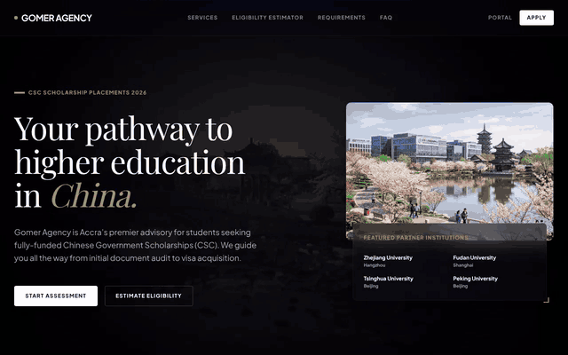

> This is a portfolio showcase of my work. The source code is private, and nothing here is open for reuse. See [All Rights Reserved](#all-rights-reserved).

## At a glance

| | |
| --- | --- |
| **What I built** | A marketing site with an eligibility estimator, a student portal and an advisor admin panel, in one Next.js app |
| **My role** | Sole developer: product specs, UI design, front end, Firebase data model, security rules and deployment |
| **Stack** | Next.js 16 · React 19 · TypeScript · Tailwind CSS 4 · Firebase Auth · Cloud Firestore · Cloud Storage · Firebase Hosting |
| **Status** | Live on Firebase Hosting |

## The problem

Chinese Government Scholarships (CSC) can cover tuition, housing, insurance and a monthly stipend, but applying is hard, especially from Ghana.

- **The process is long and confusing.** Students have to collect notarised certificates, transcripts, a study plan, recommendation letters, a stamped medical form and a police report, then deal with the CSC portal, universities and the embassy.
- **One bad document can sink an application.** A cropped scan or a missing stamp is often only noticed after the deadline.
- **Students can't see progress.** They send documents over WhatsApp and email and then wait, with no idea where their file stands.
- **Advisors juggle files by hand.** Each applicant's documents and stage live in chats and folders, which makes it easy to lose track.

## The solution

Gomer Agency gives students and advisors one shared place for the whole application.

1. **Check eligibility.** A visitor picks a degree level and grade band and sees the likely scholarship tier, what it covers and the monthly stipend.
2. **Sign up and build a profile.** Students register with email or Google and complete a short profile wizard: degree, grades and preferred field.
3. **Upload documents.** The document hub lists every required item with clear instructions. Each one shows *missing*, *under review*, *approved* or *rejected*, with the advisor's reason.
4. **Follow progress.** The student dashboard shows a five-stage tracker (document audit, submitted to school, CSC nominated, visa and JW202, ready), the matched university and programme, and notes from the advisor.
5. **Advisors run the pipeline.** The admin panel is a Kanban board of every applicant. Advisors open a file, approve or reject each document, set the target university and move the student to the next stage. The student is emailed at each step.

## Features

| For students | For advisors | Platform |
| --- | --- | --- |
| Scholarship eligibility estimator | Kanban pipeline by stage | Email and Google sign-in |
| Guided sign-up and profile wizard | Search applicants by name | Role-based access (student or admin) |
| Document hub with upload progress | Credential auditor per applicant | Firestore and Storage security rules |
| Status badges and rejection reasons | Approve or reject each document | Real-time updates across screens |
| Five-stage progress tracker | Set target university, major and notes | Email on every status change |

## Screenshots

### Public website

| Home | Eligibility estimator |
| --- | --- |
| 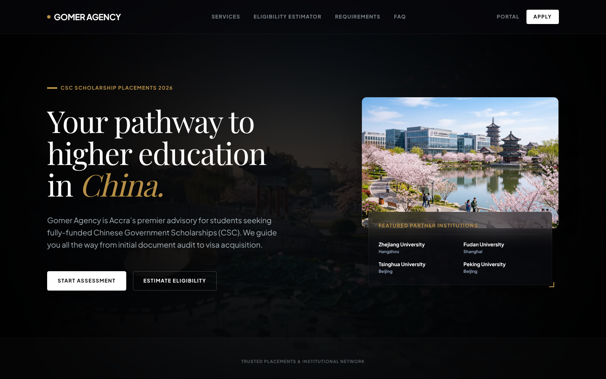 | 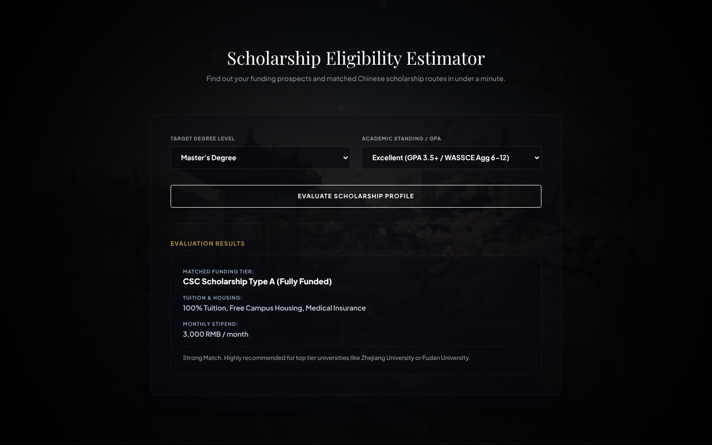 |

| Admission services | Required documents |
| --- | --- |
| 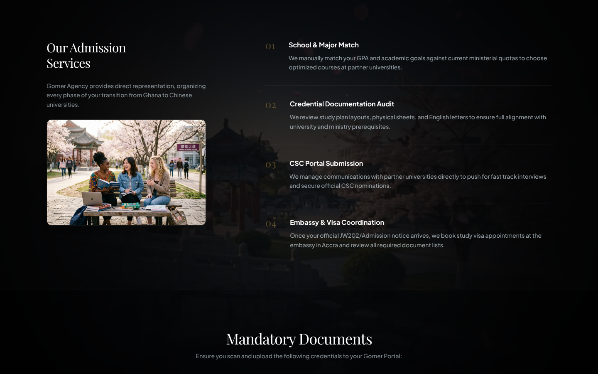 | 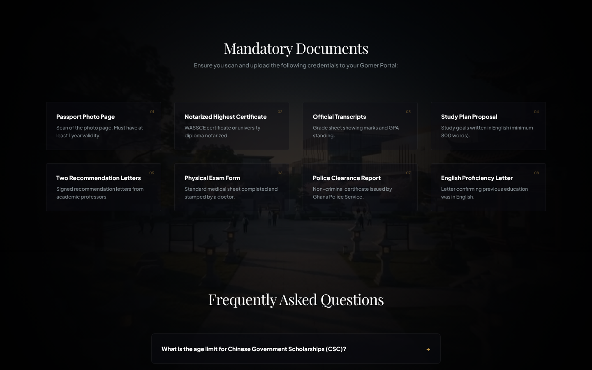 |

### Student portal

| Dashboard and progress tracker | Document hub |
| --- | --- |
| 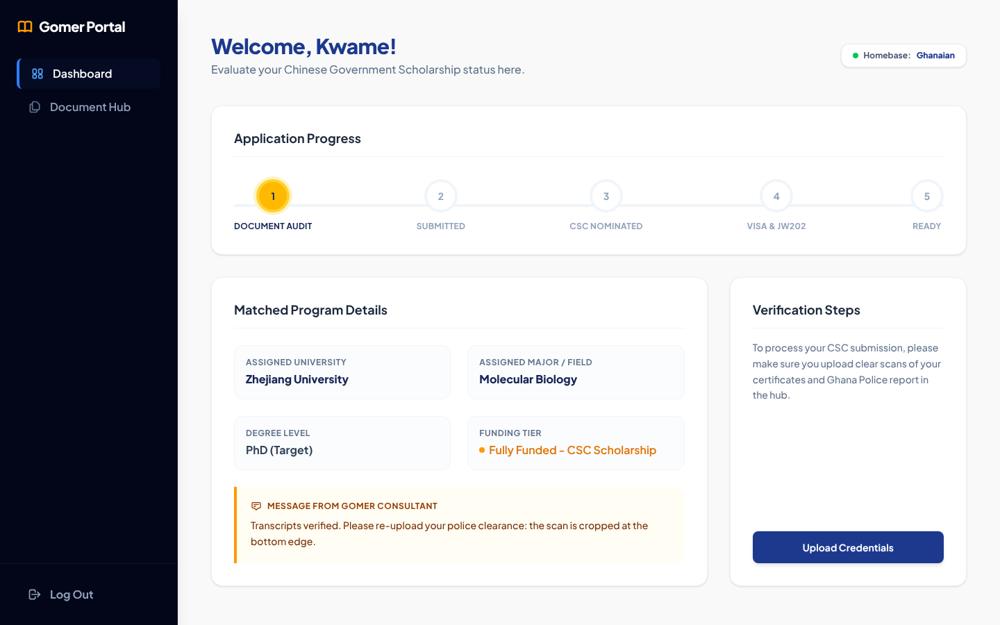 | 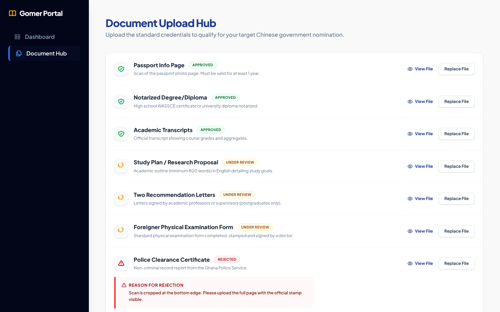 |

### Advisor admin panel

| Applicant pipeline | Credential auditor |
| --- | --- |
| 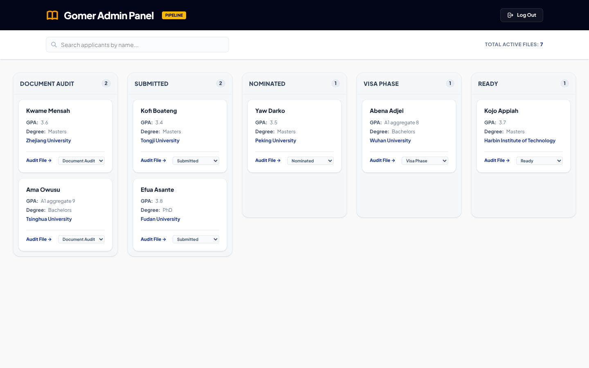 | 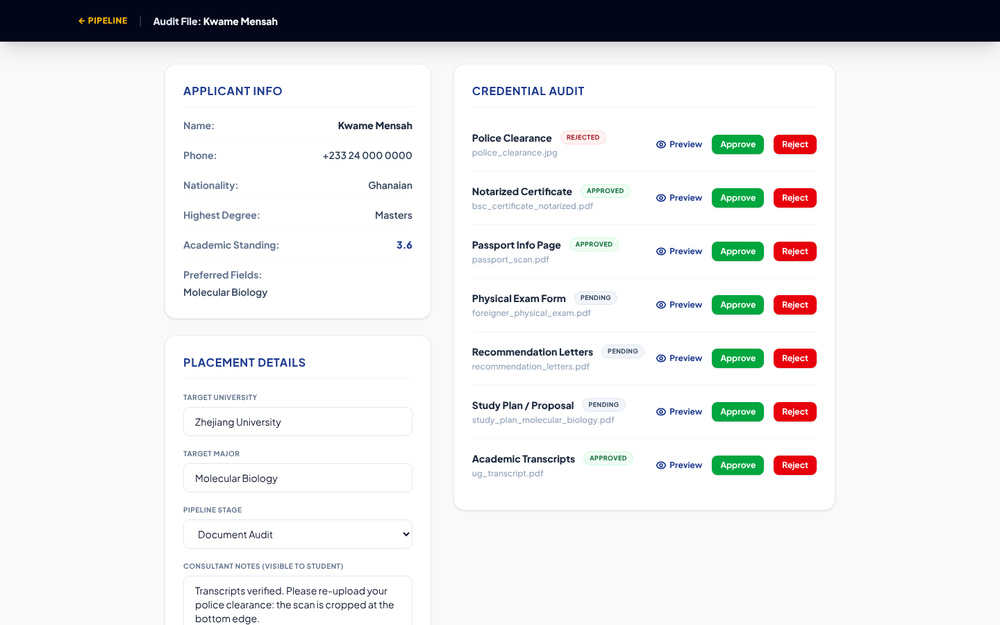 |

| Portal sign-in | Mobile home |
| --- | --- |
| 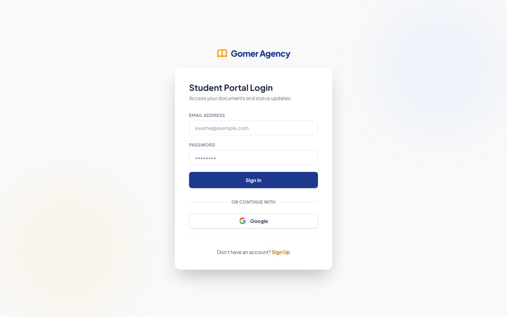 | 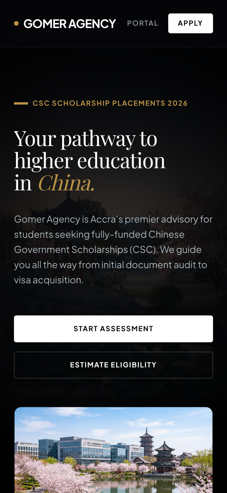 |

The public pages were captured from the live site in November 2026. The portal and admin screens show the real app running against local Firebase emulators filled with **sample data**: every student, grade and file name is invented.

## Demo video

▶ **[Watch the 40-second demo](assets/demo/gomer-demo.mp4)** (MP4, plays in the browser on GitHub)

1. A visitor checks their scholarship eligibility on the home page.
2. A student signs in and sees their progress and their advisor's note.
3. The student opens the document hub and sees which documents were approved or rejected.
4. An advisor opens the pipeline and audits the student's file.

## How it works

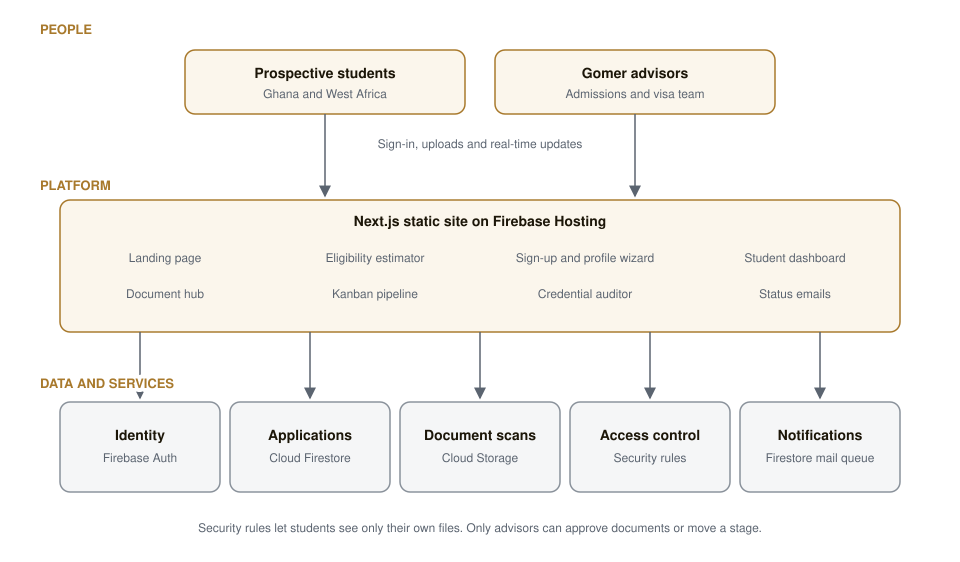

- **One Next.js app, exported as static files** and served from Firebase Hosting. There is no server to maintain.
- **Sign-in** uses Firebase Authentication with email and password or Google.
- **Profiles, applications and document records** live in Cloud Firestore. Screens subscribe to them, so a decision by an advisor shows up on the student's dashboard straight away.
- **Document scans** are uploaded to Cloud Storage with a progress bar.
- **Security rules** do the access control, because the browser talks to Firebase directly.
- **Status emails** are queued as documents in a Firestore mail collection when an advisor approves, rejects or moves a file.

## Engineering highlights

- **Security rules as the backend.** With no API server, the Firestore and Storage rules are the security boundary. Students can only read and write their own profile, application and files, and only admins can approve documents or change a stage.
- **Closed the gaps an attacker would try.** I patched rules that would have let a student approve their own documents, change protected profile fields such as their role, or escalate to admin, and fixed a Storage deletion rule that failed.
- **A role-aware app shell.** One auth context loads the user's role and sends students to the portal and advisors to the pipeline. Each page also checks the role on its own.
- **Static export with dynamic records.** The applicant file page is exported once and served for every applicant through a hosting rewrite, so a static site can still show per-applicant pages.
- **Real-time by default.** The dashboard, document hub, pipeline and auditor all use live Firestore listeners, so nobody has to refresh.
- **Written specs first.** Before any code, I wrote the business requirements, functional spec, data model, security rules plan, UI spec and a phased build roadmap.

## Tech stack

| Area | Technology |
| --- | --- |
| Framework | Next.js 16 (App Router, static export), React 19, TypeScript |
| Styling | Tailwind CSS 4, Playfair Display and Plus Jakarta Sans |
| Auth | Firebase Authentication (email and password, Google) |
| Database | Cloud Firestore with security rules |
| Files | Cloud Storage for Firebase with security rules |
| Email | Firestore mail queue |
| Hosting | Firebase Hosting |

## The market

The platform serves students in Ghana and neighbouring English-speaking West African countries who want to study in China: school leavers with WASSCE results seeking bachelor's places, and graduates seeking fully funded master's and PhD places. Its customer is the agency, which can take on more applicants without losing track of documents or deadlines.

## Traction

- The website and portal are live at [gomer-agency-admissions.web.app](https://gomer-agency-admissions.web.app).
- Applicant and placement numbers are not published yet.

## Try it

- **Live site:** [gomer-agency-admissions.web.app](https://gomer-agency-admissions.web.app)
- **Demo video:** [assets/demo/gomer-demo.mp4](assets/demo/gomer-demo.mp4)

## Contact

Interested in working together or seeing more of my work?

- **Email:** [7kbytesgh@gmail.com](mailto:7kbytesgh@gmail.com)
- **Portfolio:** [portfolio-eta-ivory-yshi67xev0.vercel.app](https://portfolio-eta-ivory-yshi67xev0.vercel.app)
- **GitHub:** [@7kbytes](https://github.com/7kbytes)

**More of my work**

- [Prime Expert Cargo](https://github.com/7kbytes/primecargo-showcase): a logistics platform for UAE to Ghana shipping (Flutter, Next.js, React, Node.js, PostgreSQL)
- [Prime Rental](https://github.com/7kbytes/prime-rental-showcase): car rental with Mobile Money payments and live GPS tracking (Next.js, PostgreSQL)
- [Primahk](https://github.com/7kbytes/primahk-showcase): a classifieds marketplace for Ghana (Next.js, React Native, NestJS, PostgreSQL)
- [DKI Properties](https://github.com/7kbytes/dkiproperties-showcase): a property platform for a real estate agency in Ghana (Next.js, Firestore)
- [SCC Small Poles League](https://github.com/7kbytes/sccsmallpolesleague-showcase): a grassroots football league platform (JavaScript, Supabase, Vercel)
- [MedLink](https://github.com/7kbytes/medlink-showcase): a prescription marketplace app for patients and pharmacies (Flutter, Supabase)
- [Maestro Sports](https://github.com/7kbytes/maestrosports-showcase): a production website for a football management company (Next.js)

## All Rights Reserved

© 2026 7Kbytes. All Rights Reserved. Nothing in this repository may be copied, modified, distributed or reused without prior written permission. The Gomer Agency name and branding belong to their owners and are shown for presentation only. University names are used only to describe the service. See [LICENSE](LICENSE).
